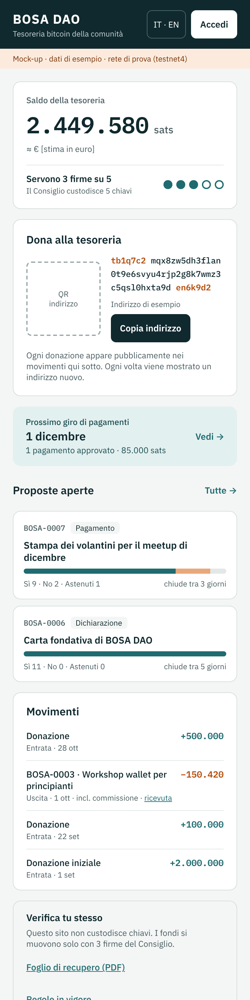
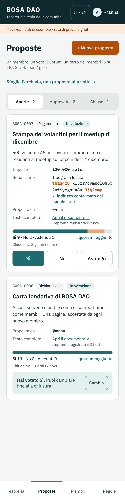

# btc-dao

A SputnikDAO-style DAO on Bitcoin alone: members propose and vote, a council of keyholders signs payouts from a multisig treasury, and anyone can audit everything.

- **Bitcoin only.** The treasury is an on-chain 3-of-5 multisig. No tokens, no other chain.
- **Approval is execution.** A payout is a PSBT; council signatures are the binding vote.
- **Keyless software.** The website never holds a key that can move funds.
- **Voters and keyholders are separate.** Members vote with a passkey on their phone; only the council's hardware keys can sign for the treasury.
- **One DAO per codebase.** Each DAO forks this repo and owns its hosting, relays and keys. There is no shared platform.
- **Always recoverable.** With the recovery sheet and 3 council seeds, any standard wallet (e.g. Sparrow) can recover the funds without this software.

## Status

**Design stage.** The specification and a clickable mock-up are complete; no application code yet. The first instance is **BOSA DAO**, a proof of concept for a local bitcoin community in Bosa, Sardinia, starting on signet.

Nothing here is ready for real funds.

| Home and treasury | Proposals | Council signing |
| --- | --- | --- |
|  |  |  |

All 17 screens are in [`design/`](design/README.md).

## Contents

| Path | What it holds |
| --- | --- |
| `docs/what-is-a-bitcoin-dao.md` | A plain-language introduction: what a Bitcoin DAO is, how it works, what it can be used for |
| `docs/spec.md` | The full specification v0.2: roles, keys, onboarding (in person and remote), treasury, governance, proposal fields, payout rounds, event formats, threat model, security requirements, build plan |
| `docs/protocol.md` | The protocol draft v1: every event's exact format, its validity rules, PSBT requirements and how a client rebuilds the DAO's state |
| `docs/decisions.md` | Decisions taken so far and open questions |
| `design/` | The mock-up screens (Italian) as source and PNG, plus the spec's diagrams |
| `tools/render-mockups/` | Regenerates the screen PNGs from the source files |
| `config/bosa-dao.signet.example.json` | Example config for the reference instance, with placeholders |
| `FORK-TASKS.md` | What must be true before this repo counts as released |

## Build plan

1. **Signet prototype**: passkey sign-in, proposals and votes as Nostr events, 3-of-5 signet treasury, payout round end to end.
2. **Hardware signing on signet**: SeedSigner QR signing, recovery sheet, restore tested in Sparrow.
3. **BOSA DAO on mainnet**: key ceremony, capped treasury, three monthly rounds without developer help.
4. **Fork kit**: setup wizard, template repo, one-click deploy, dashboard listing.

## Licence

Not yet chosen. The licence is added last, once the fork tasks are done and the code is field-tested.
